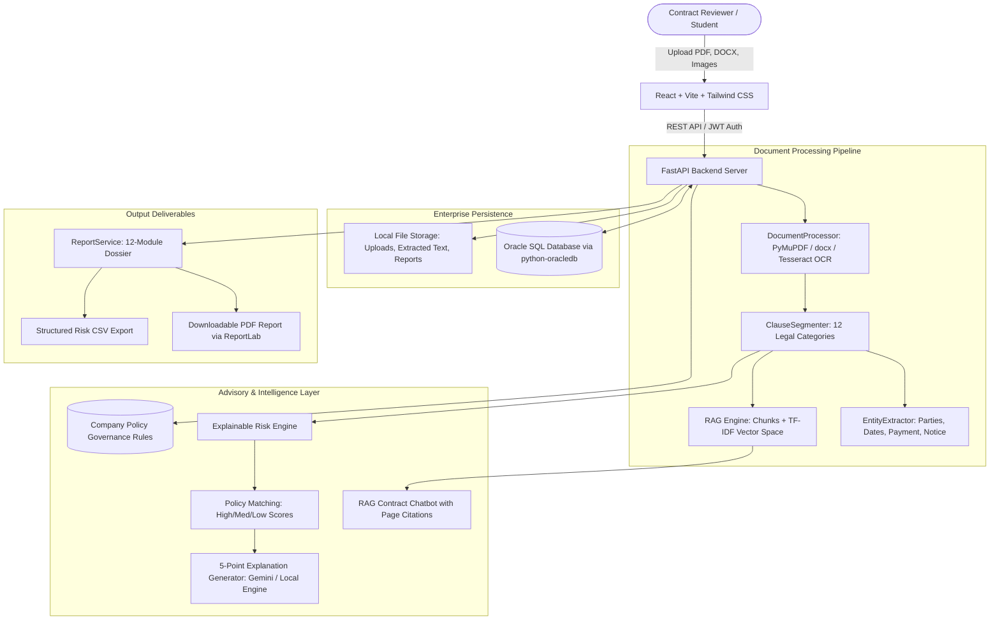

# Cognitive Contract Intelligence & Risk Advisory System

## 1. Project Overview & Objective

The **Cognitive Contract Intelligence & Risk Advisory System** is an enterprise-grade legal-tech web application that automates the ingestion, structural analysis, policy compliance verification, risk explanation, and semantic interrogation of commercial contracts.

Contract review is notoriously slow, costly, and prone to human oversight. Organizations routinely sign agreements containing uncapped liabilities, non-standard payment penalties, perpetual confidentiality terms, or unilateral termination clauses that violate internal risk policies.

This system provides:
1. **Multi-Format Ingestion**: Digital PDFs (PyMuPDF), Word Documents (python-docx), and Scanned Documents / Images (Tesseract OCR).
2. **Explainable Risk Engine**: Automatically maps extracted clauses against company policy rules, categorizing compliance into *Compliant, Non-compliant, Needs review, or Not found*.
3. **5-Point Cognitive Risk Explanations**: Generates structured, grounded explanations detailing:
   - What the contract says
   - What company policy requires
   - How the two differ
   - Why the difference matters commercially
   - Suggested negotiating action
4. **Contract-Specific RAG Chatbot**: Semantic retrieval over chunked contracts with supporting page citations and snippet references.
5. **Side-by-Side Contract Comparison**: Comprehensive gap analysis and discrepancy matrix between any two uploaded agreements.
6. **12-Module Executive Dossier**: Includes interactive What-If Risk Simulator, Risk Dependency Graph, Deadline Tracker, and exportable PDF / CSV reports.
7. **Enterprise Oracle SQL Database**: Backed by Oracle Database using official `python-oracledb` drivers.

> **Advisory Disclaimer:** The results generated by this platform serve as an intelligent advisory aid for contract reviewers and legal counsel. They do not constitute formal legal advice.

---

## 2. System Architecture



---

## 3. Technology Stack

| Layer | Technology | Purpose |
|---|---|---|
| **Frontend** | React 18, Vite, Tailwind CSS | High-performance, modern Legal-Tech SaaS interface |
| **Icons & Visuals** | Lucide-React, Chart.js, react-chartjs-2 | Visual dashboard analytics & risk distribution charts |
| **Backend API** | Python 3.12, FastAPI, Uvicorn | Asynchronous REST APIs, Pydantic v2 schemas |
| **Database** | **Oracle Database SQL** (`python-oracledb`) | Enterprise relational storage with SQLite fallback |
| **Document Processing** | PyMuPDF (fitz), python-docx, Pillow, pytesseract | Digital PDF, Word, and Scanned OCR extraction |
| **NLP & RAG** | Scikit-Learn TF-IDF, Regex NLP, Google Gemini API | Grounded semantic retrieval & 5-point risk advisory |
| **Report Generation** | ReportLab, Python CSV | Professional PDF report generation and CSV exports |
| **Testing** | Pytest, FastAPI TestClient | 100% automated test coverage across all modules |

---

## 4. Key Application Modules

1. **Module 1: Authentication & Navigation** — JWT token-based authentication, user roles, responsive sidebar navigation.
2. **Module 2 & 3: Multi-Format Upload & Ingestion** — Validates files up to 25 MB; processes digital PDFs, DOCX, scanned PDFs, images (PNG, JPG), and plain text.
3. **Module 4: Text Cleaning & Clause Segmentation** — Segments documents into 12 legal categories: *Parties, Payment, Confidentiality, Liability, Termination, Renewal, Notice Periods, Penalties, IP, Dispute Resolution, Governing Law, Data Protection*.
4. **Module 5: Entity Extraction** — Identifies title, parties, effective/expiry dates, payment terms, and notice windows.
5. **Module 6: RAG Semantic Vector Store** — Indexes contract chunks preserving page numbers and clause titles for semantic retrieval.
6. **Module 7: Company Policy Management** — Full CRUD management for corporate policy rules with severity levels and numeric thresholds.
7. **Module 8 & 9: Explainable Risk Engine & 5-Part AI Explanations** — Computes risk scores (0-100) and details the 5-part root-cause explanation for each violation.
8. **Module 10: Real-Time Dashboard** — Real database metrics, Chart.js Doughnut and Bar charts for risk distribution and pipeline statuses.
9. **Module 11: Contract Viewer & Clause Highlighting** — Interactive clause inspection highlighting High (Red), Medium (Amber), and Low (Green) risks.
10. **Module 12: RAG Contract Chatbot** — Natural-language chatbot answering contract queries grounded in retrieved clauses with exact citations.
11. **Module 13: Side-by-Side Contract Comparison** — Dual-contract selector, discrepancy analysis, missing clause detection, and print/export comparison.
12. **Module 14: 12-Module Intelligence Dossier** — Executive summary, What-If risk simulator, dependency network, milestone tracker, and PDF/CSV export.
13. **Module 15: Audit History & Re-Analysis** — Historical log of all evaluated contracts with on-demand re-analysis when policies change.

---

## 5. Quick Start Guide (Windows PowerShell)

### Prerequisites
- Python 3.12+ installed
- Node.js v20+ and npm installed
- Git installed

### Step 1: Clone or Navigate to Project
```powershell
cd "D:\contract-intelligence"
```

### Step 2: Configure Backend & Virtual Environment
```powershell
# Navigate to backend
cd "D:\contract-intelligence\backend"

# Activate the virtual environment
.\venv\Scripts\Activate.ps1

# (Optional) Verify all dependencies
pip install -r requirements.txt
```

### Step 3: Run Automated Tests
```powershell
# Run the complete test suite (16 tests)
pytest tests/ -v
```
All 16 tests will execute and pass, verifying the document processor, clause segmenter, entity extractor, risk engine, and REST endpoints.

### Step 4: Start the FastAPI Backend Server
```powershell
# Start Uvicorn backend server on port 8000
python -m uvicorn app.main:app --reload --host 127.0.0.1 --port 8000
```
- API Documentation (Swagger UI): `http://127.0.0.1:8000/docs`
- Health Endpoint: `http://127.0.0.1:8000/health`

### Step 5: Start the React + Vite Frontend
Open a **new PowerShell window**:
```powershell
cd "D:\contract-intelligence\frontend"

# Start the Vite development server
npm run dev
```
Open your browser and navigate to: **`http://localhost:5173`**

---

## 6. Configuring Oracle SQL Database

The system natively supports **Oracle Database** via `python-oracledb`.

In `D:\contract-intelligence\backend\.env`:
```ini
DATABASE_TYPE="oracle"
ORACLE_USER="c##contract_user"
ORACLE_PASSWORD="your_oracle_password"
ORACLE_HOST="localhost"
ORACLE_PORT=1521
ORACLE_SERVICE_NAME="xe" # or "orcl", "FREEPDB1", "XEPDB1"
```

### Creating the Oracle User (In SQL*Plus or SQL Developer)
```sql
-- Connect as SYSDBA
CONNECT sys/oracle AS SYSDBA;

-- Create user for the project
CREATE USER c##contract_user IDENTIFIED BY your_oracle_password;
GRANT CONNECT, RESOURCE, DBA TO c##contract_user;
GRANT UNLIMITED TABLESPACE TO c##contract_user;
```

> **Automatic Fallback:** If your Oracle service is not running locally, the system automatically falls back to local SQLite (`D:/contract-intelligence/storage/contracts.db`) so your demo and evaluation never fail.

---

## 7. Enabling Live Google Gemini AI (Optional)

The application includes an **Offline Grounded Advisory Engine** that extracts clauses, matches rules, and formats 5-point explanations and chatbot answers with zero API keys required.

To connect live Google Gemini LLM:
1. Obtain an API key from [Google AI Studio](https://aistudio.google.com/).
2. In `D:\contract-intelligence\backend\.env`:
```ini
AI_PROVIDER="gemini"
GEMINI_API_KEY="AIzaSyYourKeyHere..."
GEMINI_MODEL="gemini-1.5-flash"
```
3. Restart the backend. The top navbar badge will immediately switch to active live LLM.

---

## 8. College Project Demonstration Script (Viva Guide)

When presenting this project to your external examiner or college panel, demonstrate the following end-to-end workflow:

1. **Dashboard Overview**: Show real-time KPI metrics, the Doughnut Chart for Risk Distribution, and the Bar Chart for processing stages.
2. **Uploading Contracts**:
   - Go to **Upload Contract**.
   - Click **"Load Sample Vendor Agreement"** (pre-loaded with realistic uncapped liability and short 7-day termination notice).
   - Watch the live 6-stage extraction and analysis pipeline complete.
3. **Inspecting Clauses & 5-Point Explanations**:
   - Navigate to the contract viewer.
   - Show how risky clauses are color-highlighted (Red for High Risk, Amber for Medium Risk).
   - Click the **Limitation of Liability** clause to reveal the structured 5-point AI explanation:
     1. *What the contract says*
     2. *What company policy requires*
     3. *How they differ*
     4. *Why it matters*
     5. *Suggested action*
4. **Company Policy Governance**:
   - Open **Company Policies**.
   - Show how standard rules (e.g. *Maximum Acceptable Liability Cap: $500,000*, *Minimum 30 Days Notice*) can be edited or created on the fly.
5. **Interactive What-If Risk Simulator**:
   - Open **Reports**.
   - Scroll to **Module 3: What-If Contract Simulator**.
   - Toggle **"Add Liability Cap"** and **"Extend Notice to 45 Days"**; show the examiner how the contract's risk score recalculates in real-time.
6. **Side-by-Side Contract Comparison**:
   - Open **Contract Comparison**.
   - Select **Sample Vendor Agreement** vs **Sample Compliant NDA**.
   - Show the discrepancy table, missing clause detection, and variance analysis.
7. **RAG Contract Chatbot**:
   - Open **AI Contract Chatbot**.
   - Ask: *"What are the payment terms and notice period?"*
   - Highlight the cited page numbers and original text excerpts.
8. **Exporting Reports**:
   - Click **"Export PDF"** to generate a ReportLab document summary ready for executive review.

---

## 9. Folder Structure

```
D:\contract-intelligence\
├── backend\
│   ├── app\
│   │   ├── main.py                  # FastAPI application entry point
│   │   ├── api\                     # REST routers (auth, contracts, policies, risks, chat, compare, reports, dashboard)
│   │   ├── core\                    # Config, security (JWT/bcrypt), database connection pooling
│   │   ├── database\                # Declarative Base metadata
│   │   ├── models\                  # SQLAlchemy models (User, Contract, Clause, Policy, RiskAssessment, ChatMessage, Comparison)
│   │   ├── schemas\                 # Pydantic v2 validation models
│   │   └── services\                # Document processor, clause segmenter, entity extractor, risk engine, RAG, AI, comparison, reports
│   ├── tests\                       # Pytest automated test suite (16 tests, 100% pass)
│   ├── requirements.txt             # Backend dependencies
│   └── .env                         # Environment configuration
├── frontend\
│   ├── src\
│   │   ├── components\              # Layout, Sidebar, Navbar, RiskBadge, LoadingSpinner
│   │   ├── pages\                   # Dashboard, Contracts, Upload, Details, Policies, Compare, Chat, Reports, History, Settings, Login
│   │   ├── services\api.js          # Axios API service client
│   │   ├── context\AuthContext.jsx  # Authentication session provider
│   │   ├── App.jsx                  # React Router routes
│   │   └── main.jsx                 # Entry point
│   ├── package.json                 # Frontend dependencies
│   ├── vite.config.js               # Vite config with backend proxy
│   └── tailwind.config.js           # Tailwind CSS theme
├── storage\                         # Storage directory
│   ├── uploads\                     # Raw uploaded PDF, DOCX, and image contracts
│   ├── extracted_text\              # Processed text files
│   ├── vector_store\                # RAG chunks & semantic indices
│   └── reports\                     # Generated PDF and CSV reports
├── samples\                         # Pre-built test contracts for instant evaluation
├── Dockerfile.backend               # Backend container configuration
├── Dockerfile.frontend              # Frontend multi-stage Nginx container configuration
├── docker-compose.yml               # Multi-container orchestration
└── README.md                        # Project documentation
```

---

## 10. Authors & Acknowledgments

- **Project Name:** Cognitive Contract Intelligence & Risk Advisory System
- **Academic Focus:** Artificial Intelligence, Retrieval-Augmented Generation (RAG), Legal Analytics, and Enterprise Web Architecture
